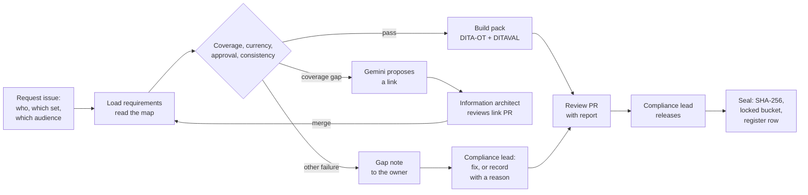

# AEGIS

**Build regulator-ready evidence from the DITA source, and prove that each
item is covered, current, and approved.**

Developers, architects, and support engineers read documentation to do a job.
A new group of readers reads it to check a claim: compliance leads, the EU AI
Office, national authorities, and downstream providers who build on a model.
They need every statement with its version, its source, and the person who
approved it.

A DITA source in Git already holds all three. AEGIS (AI Evidence and
Governance Integrity System) is an agent that turns that source into an
evidence pack. Each requirement is a DITA topic. A relationship table links
each requirement to the topics that answer it. Four deterministic checks
decide whether the pack can be released. Gemini only proposes a link where a
requirement has none, and a person approves it.

The model never approves a link, never releases a pack, and never edits a
topic.

**[Read the design document](https://siddharthraop.github.io/AEGIS/)**

## Status

Version 0.1.0 (October 2026), built and live.

- **Try it:** [siddharthraop.github.io/AEGIS/try/](https://siddharthraop.github.io/AEGIS/try/). Pick a reader (AI
  Office, downstream provider or public), see the four checks run on the Gemma 4 source in
  [dita-corpus](https://github.com/siddharthraop/dita-corpus/tree/main/gemma), then act in a private sandbox: ask
  Gemini to propose a link and approve or reject it, record a decision for a gap, plant an authority-only key and watch
  `check_consistency` block the release, and download the pack with its manifest, report and SHA-256 hashes.
- **Ask the corpus:** [siddharthraop.github.io/AEGIS/ask/](https://siddharthraop.github.io/AEGIS/ask/). Each point of
  an answer cites a topic with its commit, revised date, approver and the requirements it answers.
- **Help:** [online help](https://siddharthraop.github.io/AEGIS/help/) with context-sensitive help on the pages, the
  [user guide (PDF)](https://siddharthraop.github.io/AEGIS/help/aegis-user-guide.pdf), and the
  [developer docs](https://siddharthraop.github.io/AEGIS/dev/).
- **Release and seal:** an [Evidence request](https://github.com/siddharthraop/AEGIS/issues/new?template=evidence-request.yml)
  issue builds the pack and posts its report; a code owner comments `/release <reason>` to seal it.

The design document's simulator is still a scripted demo; the sandbox is the working version. Hours and costs in the
design document are modeled, and they're labeled as modeled where they appear.

AEGIS is a documentation tool. It isn't legal advice, and it doesn't decide
whether an obligation applies.

## The problem

The EU AI Act names four readers for information about a general-purpose AI
model ([Article 53](https://artificialintelligenceact.eu/article/53/)):

| Reader | Receives | Time limit |
| ------ | -------- | ---------- |
| AI Office and national authorities | Technical documentation ([Annex XI](https://artificialintelligenceact.eu/annex/11/)) | On request |
| Downstream providers | Integration information ([Annex XII](https://artificialintelligenceact.eu/annex/12/)) | 14 days in the [Code of Practice](https://artificialintelligenceact.eu/code-of-practice-overview/) |
| Public | Summary of training content | At release |
| Compliance lead (internal) | Evidence for each requirement | Before release |

These obligations have applied since August 2, 2025. The
[Digital Omnibus on AI](https://artificialintelligenceact.eu/ai-act-explorer/digital-omnibus/)
moved the high-risk dates later, but it didn't move these. Since August 2,
2026, the Commission can fine a provider up to 3% of worldwide turnover for
information that is incorrect, incomplete, or misleading
([Article 101](https://artificialintelligenceact.eu/article/101/)).

Today, packs are built by hand. A compliance lead copies text from published
pages into the Model Documentation Form, tracks progress in a spreadsheet, and
confirms approvals by email. The pack can't show which version of each
statement was sent or who approved it, and it starts to drift the day it's
sent.

The public [Gemma 4 model card](https://ai.google.dev/gemma/docs/core/model_card_4)
shows the starting point. Checked against Annex XI, Section 1, 7 of its 11
items are missing, partial, or stated two different ways:

| Annex XI item | Gemma 4 model card |
| ------------- | ------------------ |
| 1(a) Intended tasks | Stated |
| 1(b) Acceptable use | Linked |
| 1(c) Release date, distribution | Not stated |
| 1(d) Architecture, parameters | Stated |
| 1(e) Input and output | Two statements: video in the introduction, not in the modality table |
| 1(f) License | Two statements: Apache 2.0 on the card, Gemma Terms on the overview |
| 2(a) Integration means | Partly |
| 2(b) Design and training method | Partly |
| 2(c) Training data | Stated |
| 2(d) Training compute | Not stated |
| 2(e) Energy use | Not stated |

This doesn't mean Google lacks the information. Annex XI documentation goes
to the AI Office on request and isn't public. It shows how much of a pack
built from public pages still has to be chased by hand.

The usual ways to answer a request each miss something:

| Option | What it misses |
| ------ | -------------- |
| Copy into the form and track in a sheet | No link to the source version. No proof of approval. |
| Governance, risk, and compliance platform | A second copy of the content that writers don't maintain. |
| A chat assistant fills the form | No source, no version, and no approver. |
| Wiki page approval (first AEGIS design) | The approval sits apart from the source the docs are built from. |
| **AEGIS: evidence from the source** | **Can't decide if an obligation applies. Can't write a missing fact.** |

## What it does



For each request, the agent does the following:

1. Loads the requirement set for the request: Annex XI, Annex XII, or a set of
   [NIST AI RMF](https://www.nist.gov/itl/ai-risk-management-framework)
   subcategories. Each requirement is a DITA topic with a key.
1. Reads the evidence map: the relationship table, each evidence topic's
   prolog and keys, and the Git log and pull request reviews for each file.
1. Runs four checks. The checks decide whether the pack can be released.
1. For requirements with no evidence only, asks Gemini to propose a link. The
   proposal goes to a branch as a pull request. A proposal with a confidence
   under 0.6 becomes a gap note instead.
1. Builds the pack with DITA-OT and the request's DITAVAL profile, and writes
   a manifest and a coverage report.
1. Opens a review pull request and asks the compliance lead to release it.
1. After release, hashes each file, uploads the pack to a Cloud Storage bucket
   with a locked 10-year retention policy, and writes a register row.

### Governance in DITA

AEGIS adds no new format. It uses DITA 1.3 features that a documentation team
already knows:

| DITA or Git feature | Governance job | Checked by |
| ------------------- | -------------- | ---------- |
| [`<reltable>`](https://docs.oasis-open.org/dita/dita/v1.3/os/part1-base/langRef/base/reltable.html) in the evidence map | Trace each requirement to its evidence | `check_coverage` |
| `<critdates>`, `model-version` metadata | Show the version and date of each statement | `check_currency` |
| Pull request reviews, [code owners](https://docs.github.com/en/repositories/managing-your-repositorys-settings-and-features/customizing-your-repository/about-code-owners) | Show who approved each statement | `check_approval` |
| Keys and `keyref` | One value in every pack | `check_consistency` |
| [`@audience` and DITAVAL](https://dita-lang.org/1.3/dita/archspec/base/condproc) | Give each reader only their part | `check_consistency` (leak test) |
| Subject scheme map | Allow only known audience values and keys | The DITA-OT build |

The prolog says who should own a topic. Git records who approved it. AEGIS
trusts Git for approval.

### The four checks

| Check | Passes when |
| ----- | ----------- |
| `check_coverage` | Every requirement has at least one evidence topic that survives the pack's profile. |
| `check_currency` | Each topic was revised on or after the model version date, or holds only key references whose keys changed in an approved commit after that date. |
| `check_approval` | The last change to each topic merged through a pull request approved by a code owner who isn't the author or the agent. |
| `check_consistency` | Every value resolves from a key, and no authority-only key appears in the public or downstream build. |

### One source, three packs

The same source builds a pack for each reader. Authority-only topics exist
once and are never copied.

| Pack | Profile | Requirement set | Sent to |
| ---- | ------- | --------------- | ------- |
| Public model card | `public.ditaval` | Model card sections | Anyone |
| Downstream pack | `downstream.ditaval` | Annex XII, 11 items | Downstream providers |
| Authority pack | `authority.ditaval` | Annex XI, Section 1, 11 items | AI Office, national authorities |

### Agent tools

The agent is built with
[Agent Development Kit](https://github.com/google/adk-docs). It has ten tools.
Only one of them calls the model.

| Tool | Type | What it does |
| ---- | ---- | ------------ |
| `load_requirements` | Deterministic | Loads the requirement topics for the request |
| `read_evidence_map` | Deterministic | Reads links, prolog dates, keys, commits, and reviews |
| `check_coverage` | Check | Every requirement has evidence |
| `check_currency` | Check | Evidence is current for the model version |
| `check_approval` | Check | Every change was approved by a code owner |
| `check_consistency` | Check | One value per key, and no leaks between audiences |
| `propose_mapping` | Model | Gemini proposes a link for an unmapped requirement |
| `build_pack` | Deterministic | Builds the pack, manifest, and report with DITA-OT |
| `open_review` | Deterministic | Opens the review pull request and gap issues |
| `seal_pack` | Deterministic | Hashes, uploads to a locked bucket, and registers the pack |

`propose_mapping` sends Gemini only the requirement text and the titles and
short descriptions of candidate topics. It never sends the body of an
authority topic. The schema is built for each run, so the candidate list holds
only topic IDs that exist.

## Sample output

The manifest turns documentation into evidence. For each requirement, it
records which topic answered it, from which commit, on which date, and with
whose approval. It also records every gap and the decision about it.

```json
{
  "pack_id": "gemma4-aia-xi-2026-10-20-01",
  "request": { "from": "AI Office", "basis": "Article 53(1)(a)", "issue": 456 },
  "source":  { "commit": "9c41e7a", "profile": "authority.ditaval", "model_version": "gemma-4" },
  "items": [
    { "req": "aia.xi-1d", "topics": ["gemma4-models-overview"],
      "revised": "2026-07-30", "approved_by": "technical-writer", "pr": 418, "checks": "pass" },
    { "req": "aia.xi-2d", "topics": ["gemma4-training-infrastructure"],
      "revised": "2026-07-30", "approved_by": "training-lead",
      "link": { "proposed_by": "propose_mapping", "confidence": 0.86,
                "approved_by": "information-architect", "pr": 457 } },
    { "req": "aia.xi-2e", "topics": [], "checks": "gap",
      "decision": { "by": "compliance-lead", "date": "2026-10-20",
                    "note": "energy estimate due with next release; issue 458" } }
  ],
  "files":    [{ "path": "gemma4-annex-xi.pdf", "sha256": "3b7f…a91c" }],
  "released": { "by": "compliance-lead", "pr": 459 },
  "sealed":   { "bucket": "aegis-evidence", "retention": "315360000s, locked" }
}
```

A link that Gemini proposed is labeled as proposed, with the person who
approved it. A gap is never hidden. It ships in the report with a decision, a
name, and a date.

## How you know it works

AEGIS is measured on the Gemma 4 sample source, with one authority pack and
one downstream pack.

| Metric | MVP target |
| ------ | ---------- |
| Requirements in a released pack that are covered, current, and approved | 100%, or a recorded decision for each gap |
| Items with a named human approver from Git | 100% |
| Values in packs that resolve from a key | 100% |
| Authority content found in public or downstream output | 0 |
| Time from request to a pack ready for release | Under 1 working day |
| People hours per pack | Under 4, against a modeled 32 by hand |
| Packs sealed with a locked policy and a manifest hash | 100% |

**Known limits.** AEGIS proves that evidence exists, is current, was
approved, and is consistent. It doesn't prove that the evidence is true, or
that it's legally sufficient. A locked retention policy can't be removed or
shortened, so the POC tests with a short, unlocked policy first.

## Technology

The MVP runs on Google Cloud and free or open-source tools.

| Part | Technology | Free tier or license |
| ---- | ---------- | -------------------- |
| Agent framework | [Agent Development Kit](https://github.com/google/adk-docs) | Apache 2.0 |
| Model | [Gemini 3.8 Flash](https://ai.google.dev/gemini-api/docs/models/gemini-3.8-flash) (`gemini-3.8-flash`) with [structured output](https://ai.google.dev/gemini-api/docs/structured-output) | [Gemini API free tier](https://ai.google.dev/gemini-api/docs/pricing) |
| Pack build | DITA-OT 4.4 with DITAVAL | Apache 2.0 |
| Trigger and approval record | GitHub Actions, [protected branches](https://docs.github.com/en/repositories/configuring-branches-and-merges-in-your-repository/managing-protected-branches/about-protected-branches), code owners | [Free for public repositories](https://docs.github.com/en/billing/concepts/product-billing/github-actions) |
| Agent runtime | Cloud Run job | [Free tier](https://cloud.google.com/free) |
| Sealed packs | Cloud Storage with [Bucket Lock](https://docs.cloud.google.com/storage/docs/bucket-lock) | 5 GB-months of Standard storage |
| Pack register | BigQuery | 1 TB of queries a month |
| Secrets | Secret Manager | 6 secret versions a month |

**Data handling.** The sample content is public, so the Gemini API free tier
is acceptable for the MVP. Content sent on the free tier is used to improve
Google products, so a real deployment needs the paid tier
([Gemini API pricing](https://ai.google.dev/gemini-api/docs/pricing)).

## Run locally

```sh
git clone --recurse-submodules https://github.com/siddharthraop/AEGIS.git && cd AEGIS
pip install -e '.[api,test]'
python scripts/approval_index.py          # Git history and pull request reviews for the Gemma set
python -m pytest -q
uvicorn api.main:app --port 8080
cd site && python3 -m http.server 8000    # http://localhost:8000/try/?api=http://localhost:8080
```

See [local development](https://siddharthraop.github.io/AEGIS/dev/dev/local-development.html) for DITA-OT and the
environment variables.

## Repository contents

| Path | Description |
| ---- | ----------- |
| `index.html` | The design document |
| `aegis/` | Corpus reader, DITAVAL profiles, approval index, the four checks, pack builder, `propose_mapping`, Ask |
| `api/` | FastAPI service on Cloud Run |
| `site/` | The sandbox (`/try/`), Ask (`/ask/`) and shared assets |
| `packs/` | The public profile, model card sections, version dates and the authority-only keys for the leak test |
| `scripts/` | Approval index and DITA-OT pack builds |
| `help/` | DITA help set and user guide bookmap |
| `docs/` | Developer docs and ADRs (MyST) |
| `tests/` | pytest suite |
| `corpus/` | dita-corpus, as a submodule |

## Sample content and attribution

The sample content is adapted from the Google AI for Developers
documentation:
[Gemma 4 model card](https://ai.google.dev/gemma/docs/core/model_card_4),
[Gemma 3 model card](https://ai.google.dev/gemma/docs/core/model_card_3), and
[Gemma models overview](https://ai.google.dev/gemma/docs/core). Google
publishes this content under the
[Creative Commons Attribution 4.0 License](https://creativecommons.org/licenses/by/4.0/),
as described in the
[Google Developers Site Policies](https://developers.google.com/site-policies).
The adapted content is modified from the original. The requirement topics,
evidence map, authority-only topics, and manifests are written for this design
and aren't part of Google's published pages.

Regulatory text is paraphrased from
[Regulation (EU) 2024/1689](https://eur-lex.europa.eu/eli/reg/2024/1689/oj)
and [NIST AI 100-1](https://nvlpubs.nist.gov/nistpubs/ai/nist.ai.100-1.pdf).

This is a portfolio project. Google hasn't engaged, sponsored, or endorsed
this work. Stakeholders in the design document are job roles, not real
people, and the readers are fictional.

## Part of a series

This project is the fifth in a series of design documents. Each one solves
one economic problem in documentation, and each builds on the same Google
sample content.

1.  [MANIFEST](https://siddharthraop.github.io/Manifest/): migrate DITA XML to
    docs as code and prove that no content was lost.
1.  [The Autonomous Author](https://siddharthraop.github.io/The-Autonomous-Author/):
    run the docs loop at the pace of the code loop, with a first draft on every
    merge.
1.  [KnowledgeFlow](https://siddharthraop.github.io/KnowledgeFlow/): answer
    questions across documentation silos, from the links writers already
    maintain.
1.  [AlignR](https://siddharthraop.github.io/AlignR/): generate new DITA topics
    from the ones you have, and check them against the schema before a writer
    sees them.
1.  **AEGIS**: build regulator-ready evidence from the DITA source, and prove
    that each item is covered, current, and approved.

AEGIS version 0.1 replaces an earlier design of the same name (version
1.0.0), a governance platform for a fictional asset manager with five agents
and an EU AI Act risk classifier. That version is kept under the `v1.0.0` tag.
This version keeps its evidence bundle and its human escalation, and drops
risk classification, because deciding whether an obligation applies is a legal
decision.

## Contact

Siddharth Rao. To ask a question or suggest a change,
[open an issue](https://github.com/siddharthraop/AEGIS/issues).

## License

The design document, diagrams, and code in this repository are licensed under
the [MIT License](LICENSE). Adapted Google content remains under the Creative
Commons Attribution 4.0 License.
